<!-- Cabeçalho -->

  

  

  
  
  
  <!-- LinkedIn: troque SEU-USUARIO pelo seu handle e descomente a linha abaixo
  
  -->
  

---

## 👨‍💻 Sobre mim

Sou **web designer e desenvolvedor front-end** em Campo Grande, MS. Ajudo empresas e empreendedores a terem uma presença digital forte, com **design limpo, performance e foco em resultado**: do protótipo no Figma ao deploy na Vercel.

- 🔭 Hoje estou construindo o **[GIRAVO](https://master-oficina-pro.vercel.app)**, um SaaS multi-tenant para oficinas e auto centers
- 🤖 Estudando **IA aplicada**: agentes com **Python + Gemini**, busca em documentos e integração com bancos de dados
- 🎨 Mais de **10 sites entregues para clientes reais**: landing pages, sites institucionais, portais e e-commerce
- 💬 Pode me perguntar sobre **Next.js, React, Tailwind, UI/UX e landing pages que convertem**
- ⚡ Curiosidade: meu cachorro se chama **Ringo**, nome de um refrigerante que eu tomava na minha cidade natal 🐶

---

## 🚀 Projetos em destaque

<table>
  <tr>
    <td width="50%" valign="top">
      <h3>⚡ GIRAVO Master Admin</h3>
      
Painel SaaS <b>multi-tenant</b> para oficinas e revendas: métricas em tempo real, controle de assinaturas, <i>feature flags</i> por módulo, gestão de leads e pagamentos com Stripe.

      

        
        
        
        
        
      

      <a href="https://master-oficina-pro.vercel.app">🌐 Ver online</a> · <a href="https://github.com/FernandoAlvesMachado/master-oficina-pro">💻 Código</a>
    </td>
    <td width="50%" valign="top">
      <h3>🎸 Empório da Música: Agente de IA</h3>
      
Assistente de atendimento para uma loja de instrumentos: consulta ao catálogo em <b>SQLite</b>, respostas sobre políticas a partir de <b>PDFs com referência de página</b> e conversa com o <b>Gemini</b>.

      

        
        
        
        
      

      <a href="https://github.com/FernandoAlvesMachado/emporio-musica-ai-agent">💻 Código</a>
    </td>
  </tr>
  <tr>
    <td width="50%" valign="top">
      <h3>🪐 Orbe App</h3>
      
Landing page de produto com componentes acessíveis, formulários validados e animações. Construída com uma arquitetura de UI reutilizável.

      

        
        
        
        
      

      <a href="https://orbe-lp.vercel.app">🌐 Ver online</a> · <a href="https://github.com/FernandoAlvesMachado/orbe-lp">💻 Código</a>
    </td>
    <td width="50%" valign="top">
      <h3>📰 Portal de Notícias</h3>
      
Portal com gerenciamento de conteúdo para publicar artigos e melhorar o SEO, desenvolvido do zero em PHP.

      

        
        
        
      

      <a href="https://sites-eosin.vercel.app">🌐 Ver online</a> · <a href="https://github.com/FernandoAlvesMachado/portal-de-noticias">💻 Código</a>
    </td>
  </tr>
</table>

### 🎨 Sites entregues para clientes

| Projeto | Segmento | Link |
| --- | --- | --- |
| **APVS Brasil** | Proteção veicular | [protecao-veicular-xi.vercel.app](https://protecao-veicular-xi.vercel.app) |
| **ID Singular** | Educação corporativa | [id-singular-wireframe.vercel.app](https://id-singular-wireframe.vercel.app) |
| **Adney Andrade** | Aulas de música | [professor-de-musica.vercel.app](https://professor-de-musica.vercel.app) |
| **Boa Rifa** | Landing page + pack visual | [landing-page-boarifa.vercel.app](https://landing-page-boarifa.vercel.app) · [Pack Visual Pro](https://pack-divulgacao.vercel.app) |
| **Gráfica Foco** | Gráfica | [landing-page-grafica-foco.vercel.app](https://landing-page-grafica-foco.vercel.app) |
| **Headline** | Landing page | [headline-beta.vercel.app](https://headline-beta.vercel.app) |
| **Desentupidora** | Serviços locais | [desentupidora-psi.vercel.app](https://desentupidora-psi.vercel.app) |
| **Cuidadora** | Saúde e cuidados | [cuidadora-lilac.vercel.app](https://cuidadora-lilac.vercel.app) |
| **Brinquedos** | Varejo | [brinquedos-chi.vercel.app](https://brinquedos-chi.vercel.app) |

<a href="https://www.behance.net/fernandopwe">➡️ Veja o portfólio de design completo no Behance</a>

---

## 🛠️ Stack

<table align="center">
  <tr>
    <td align="center"><b>Front-end</b></td>
    <td></td>
  </tr>
  <tr>
    <td align="center"><b>Back-end & Dados</b></td>
    <td></td>
  </tr>
  <tr>
    <td align="center"><b>Design</b></td>
    <td></td>
  </tr>
  <tr>
    <td align="center"><b>Cloud & Ferramentas</b></td>
    <td></td>
  </tr>
</table>

---

## 📊 Atividade no GitHub

  
  

  

<picture>
  <source media="(prefers-color-scheme: dark)" srcset="./profile/snake-dark.svg" />
  <source media="(prefers-color-scheme: light)" srcset="./profile/snake.svg" />
  
</picture>

---

## 🤝 Vamos trabalhar juntos?

Tem uma ideia de projeto, precisa de um site que **venda de verdade** ou quer só dizer oi? Minha caixa de entrada está sempre aberta.

  

  

